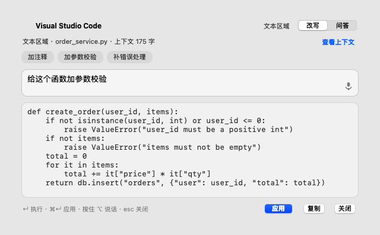
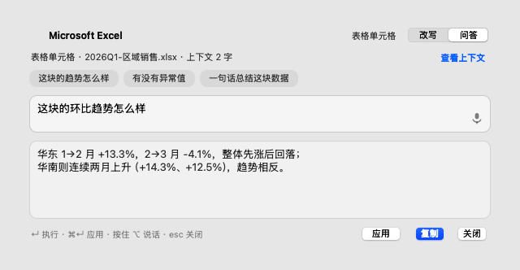
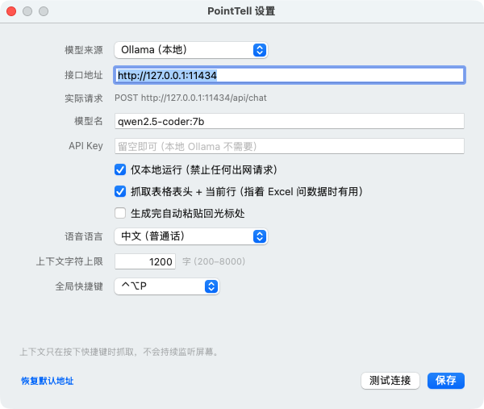
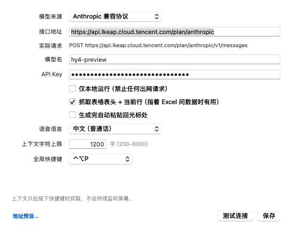

# PointTell · Point at it, change it

> Wherever your cursor points, AI edits right there. A "deictic" interaction layer for macOS.

**English** · [简体中文](README.zh-CN.md)

No selecting, no copying, no switching windows, no explaining "this thing I'm looking at". Hover over the target, hit the hotkey, say one sentence — the AI rewrites it in place, or answers about it.





---

## What it solves

Every AI tool today makes you explain the context first: select, copy, paste, then type "I'm looking at this function". Google DeepMind's AI Pointer proposes a different deal — let the cursor itself carry the context. Hover to capture it, point and say "make this twice as big".

PointTell is a lightweight macOS take on that idea: **do only "point-and-edit / point-and-ask", and do it properly.**

## What v0.1 does

- **Hover is the context**: `AXUIElementCopyElementAtPosition` reads the control under the cursor — its role, its text, and the content around the caret (not the whole document)
- **Point at a table, ask about the numbers**: it walks up to the `AXTable`, attaches the header row + current row + next row, so "how is this trending quarter over quarter" gets an answer with actual figures
- **Write back in place**: one click pastes the result at the caret of the original app (VS Code / Xcode / Excel / browsers), replacing the current selection
- **Hold ⌥ and talk**: on-device speech recognition (`requiresOnDeviceRecognition`); release to run
- **Privacy first**: defaults to a local Ollama (`127.0.0.1:11434`); in "local only" mode any outbound request is blocked. API keys live in the Keychain. Capture happens only at the instant you press the hotkey — no continuous monitoring
- **Auditable context**: "View context" shows exactly what is about to be sent to the model

## Quick start

```bash
git clone https://github.com/riemann-chow-product/point-tell.git
cd point-tell
./build.sh                 # output: build/PointTell.app
open build/PointTell.app   # an arrow icon appears in the menu bar
```

First launch walks you through **Accessibility** permission (System Settings › Privacy & Security › Accessibility). It is used to read the text of the control under the cursor and to paste the result back. Without it the app cannot work.

> **If the toggle is already on but the app still says "not granted"** — see [Why accessibility permission stays granted](#why-accessibility-permission-stays-granted). 99% of the time it is a stale record left behind by a changed code signature.

Then configure a model (pick one):

```bash
# A. Local (recommended, privacy first)
ollama pull qwen2.5-coder:7b     # code rewriting
# or smaller and faster: ollama pull qwen2.5:3b
ollama serve                     # defaults to 127.0.0.1:11434

# B. Any OpenAI-compatible API
# Menu bar icon → Settings → Provider: "OpenAI-compatible API", fill in baseURL / model / key
# Note: you must also turn off "Run locally only"

# C. Anthropic-compatible (official Claude / Tencent Cloud Hunyuan · GLM · Kimi)
# Provider: "Anthropic-compatible protocol", enter the address down to the .../anthropic level
# Tencent Cloud example: https://api.lkeap.cloud.tencent.com/plan/anthropic
# Or click "Endpoint presets…" at the bottom left instead of typing the long domain
```

## Model settings



An Anthropic-compatible (Tencent Cloud) configuration:



Menu bar icon → Settings (or `open build/PointTell.app --args --settings`).

| Field | What you can do |
| --- | --- |
| Provider | One of three: Ollama (local) / OpenAI-compatible API / Anthropic-compatible protocol. Each remembers its own address and model, so switching back and forth never overwrites the others |
| Endpoint | Free text. A missing `http://` is added for you (http for localhost/LAN, https for the public internet); a trailing `/`, `/api` or `/v1` is normalised away |
| Effective request | Read-only, shows the exact URL that will be called — no guessing how the address gets assembled |
| Model name | Free text; an empty value is rejected |
| API Key | Free text, stored in the Keychain. Can stay empty for local Ollama; required for cloud |
| Context character limit | Digits only (non-digits are filtered out), range 200–8000 |
| Endpoint presets… | Bottom left. Common endpoints; picking one also switches the provider for you |
| Everything else | Three toggles, speech language, global hotkey — all take effect immediately |

### Don't pick the wrong protocol

| Provider | Actual request | When to use |
| --- | --- | --- |
| Ollama (local) | `POST {base}/api/chat` | `ollama serve` on this machine |
| OpenAI-compatible API | `POST {base}/v1/chat/completions` | OpenAI, one-api / relay services, vLLM |
| Anthropic-compatible protocol | `POST {base}/v1/messages` | Official Claude, Tencent Cloud Anthropic-compatible (Hunyuan / GLM / Kimi) |

The wrong protocol always means a 404, so if the address contains `/anthropic` while the provider is set to OpenAI, the window tells you to switch instead of burning a request.

The easiest trap with Tencent Cloud is **the domain spelling**: it is `api.lkeap.cloud.tencent.com` (starts with L). Typing `ikeap` fails DNS resolution. "Endpoint presets…" gets it right:

- Tencent Cloud Anthropic-compatible · TokenHub plan → `https://api.lkeap.cloud.tencent.com/plan/anthropic`
- Tencent Cloud Anthropic-compatible · Knowledge Engine → `https://api.lkeap.cloud.tencent.com/api/anthropic`

**"Test connection" runs in two stages**, which is far more accurate than firing a chat request:

1. Probe the service first: `GET /api/tags` for Ollama, `GET /v1/models` for OpenAI. Instant, and it separates "service isn't running" from "model isn't pulled" — and catches an invalid API key before you spend any tokens.
2. Then actually make the model say two words (`max_tokens` capped at 32) to prove the generation path works, and report the latency.

Common results:

| Status bar | Meaning |
| --- | --- |
| `✓ Connected (1.2s) · replied "OK"` | It works |
| `✗ DNS lookup failed: xxx does not exist` | Domain typo, or you need the intranet/VPN (`i/l` and `1/I` are the usual suspects) |
| `✗ Cannot reach http://127.0.0.1:11434. Is Ollama running?` | Service not started, or wrong port/address |
| `✗ Model "xxx" is not available. Installed: a, b` | Service is up but the model isn't pulled; it lists what you do have |
| `✗ API key invalid or missing (HTTP 401)` | Cloud key problem |
| `✗ Endpoint path not found (HTTP 404)` | Wrong protocol, or the address goes one level too deep |
| `⚠️ "Run locally only" is on…` | The privacy switch blocked a cloud request; uncheck it and retest |
| `⚠️ Service and model are there, but generation timed out` | Local model cold start (especially reasoning models) — not a misconfiguration |

Two deliberate designs: **testing never writes to disk** (tweak the fields and hit test without polluting your saved config — only "Save" commits), and **switching providers never loses input** (unsaved address/model/key are stashed per provider).

### Saving

"Save", pressing return, and `⌘S` are all equivalent. On success it shows "Saved" before closing; if validation rejects something it shows red text in place and keeps the window open.

**Where the API key lives**: the Keychain first (service `com.pointtell.apikey`), mirrored to `~/Library/Application Support/PointTell/api-key.json` (mode `0600`). If both fail, saving shows a warning and **does not close the window** — it never pretends the key was stored.

Why the mirror: a Keychain item's ACL is bound to the signature that created it. Early builds used ad-hoc signing, so the cdhash changed on every compile; after switching to a fixed certificate, old items became unreadable (`SecItemCopyMatching` returns `-25293`), which shows up as "I definitely saved a key, yet I get 401". The mirror makes signature changes harmless.

Rescuing an old key: `./scripts/fix-api-key.sh` (when the Keychain read fails it pulls the value out with the `security` CLI and writes the file above); `./scripts/fix-api-key.sh --check` only reports, never writes.

### When clicking does nothing

`/tmp/pointtell.log` has a line `win.event down ... hit=... key=... active=...` that separates the three possibilities at once:

| Log | Meaning |
| --- | --- |
| No `win.event down` at all | The event never reached the window: the app wasn't active (the first click only activates it), or the window is covered |
| `win.event down` present but `hit=` is not a button | You clicked something else (layout is off) |
| `win.event down` present, `hit` is the button, but no `save: clicked` | The button's target/action isn't wired up |
| `save: clicked` present but no `save: committed` | `commit()` threw partway through — look for the `UNCAUGHT EXCEPTION` line in the same file |

## Usage

| Action | What it does |
| --- | --- |
| `⌃⌥P` | Open the panel at the cursor (hotkey is configurable) |
| Type an instruction + `↵` | Run it |
| `⌘↵` | Apply the result back into the original app (works in every mode). The panel **does not vanish immediately** — see below |
| `⌘1` / `⌘2` | Switch between rewrite / ask mode |
| Hold `⌥` and talk | Voice input; release to stop |
| `esc` | Close |

The default mode is picked from the control type: editable control → rewrite; table / static text → ask.

**The "Apply" button exists in every mode.** In ask mode the primary button is "Copy" (highlighted) and "Apply" sits next to it — so pointing at an editor and saying "translate this into English" can still write back, instead of hiding the button because of a mode guess. The mode detection itself is fixed too: role-only checks miss Sublime / Electron / web editing surfaces (their role is `AXGroup`), so once background enrichment reads `AXEditable` it corrects the mode to rewrite.

**The panel lingers after you apply.** Click "Apply" → the text is pasted immediately → the panel stays put showing "✓ Applied · closing in N s", where N scales with result length (20 chars/second, minimum 5 s, maximum 15 s). Click the panel during that window and it stays; press `esc` and it closes. It used to disappear the moment you clicked, leaving no chance to check the result.

Try it:

1. Open `demo/sample.py` in an editor, put the caret on `create_order`, `⌃⌥P` → "add parameter validation to this function" → `⌘↵`
2. Open `demo/table.html` in a browser, hover a cell → "how is this trending quarter over quarter"
3. Point at any paragraph → `⌘2` → "what's wrong with this paragraph"

## Panel colors (so you can read the text)

The panel is translucent vibrancy material — what shows through is the color of whatever is behind it. If the text color only followed the system appearance, you'd hit the classic failure: **light system theme, dark editor theme**. The material shows a dark surface while the text stays black.

So every time the panel opens it does two things:

1. **Sample the backdrop brightness**: grab roughly 40×40 px from the middle of the control under the cursor, downsample to 8×8 and take the **median** brightness (median shrugs off outliers like text and the caret). Dark backdrop → the whole panel switches to dark appearance; light → light. The entire card switches, not just the background color.
2. **A scrim as fallback**: even when the brightness can't be determined (no permission), a translucent layer tinted toward the current appearance sits on top of the material, so text keeps its contrast on any backdrop.

| "Panel colors" in Settings | Behavior |
| --- | --- |
| Auto (default) | Follows the backdrop; requires **Screen Recording** permission |
| Dark / Light | Fixed; no sampling, no permissions needed |

Without permission, "Auto" falls back to following the system appearance (still readable thanks to the scrim), and the settings window shows a "Grant Screen Recording" button. Permission changes take effect after quitting and reopening the app.

Previews: `demo/preview-rewrite.png` (light) and `demo/preview-rewrite-dark.png` (dark); regenerate with `./scripts/render-preview.sh`.

## Privacy

| Data | Where it goes |
| --- | --- |
| Control text at the cursor | Read only when you press the hotkey; sent only to the model endpoint you configured |
| Clipboard | Used briefly when applying a result, restored after 0.6 s |
| API key | Keychain (`com.pointtell.apikey`) + `~/Library/Application Support/PointTell/api-key.json` (0600); never in UserDefaults, never in logs |
| Screen | Not archived, not OCR'd, not monitored. With "Auto" colors on, ~40×40 px around the cursor is sampled once at panel-open time to compute brightness, then discarded — never written to disk, never sent anywhere |

"Run locally only" is on by default: if the provider isn't Ollama, the request is blocked and the panel says so.

## Layout

```
Sources/
├── main.swift              Entry point (menu bar app, no Dock icon)
├── AppDelegate.swift       Lifecycle + minimal main menu (without it ⌘C/⌘V break)
├── OverlayController.swift State machine: point → speak → edit
├── OverlayPanel.swift      Floating card UI (hand-written AppKit layout)
├── AXContext.swift         AX reads: role / text / selection / table slice
├── PromptBuilder.swift     System/user prompts + scenario shortcuts
├── LLMClient.swift         Streaming client (Ollama NDJSON / OpenAI SSE)
├── SpeechRecognizer.swift  On-device speech recognition
├── Paster.swift            Clipboard + synthetic ⌘V write-back
├── HotkeyManager.swift     Carbon global hotkey (no input monitoring permission needed)
├── HighlightWindow.swift   Highlight box around the hovered target
├── ScreenSampler.swift     Samples backdrop brightness → dark/light panel (adaptive colors)
├── Settings.swift          Config (UserDefaults + Keychain)
├── SettingsWindow.swift    Settings window
├── Onboarding.swift        Permission onboarding
└── Support.swift           Logging / role names / hotkey display helpers
```

```
scripts/
├── package.sh              Build dmg + zip + SHA256SUMS
├── release.sh              One-command release (version → build → tag → push)
├── render-preview.sh       Render the panel into demo/preview-*.png
├── fix-accessibility.sh    Repair Accessibility grant (clear stale record + open pane)
└── fix-api-key.sh          Rescue an old API key from the Keychain
```

The data flow of one invocation:

```
⌃⌥P
 └→ ContextCapture.probe()               Element + role under cursor (one IPC, 0.35s timeout)
     ├→ ScreenSampler.isDarkBackdrop()   Sample backdrop once → dark/light panel
     ├→ ContextCapture.enrich()          Background: body text / selection / table row
     └→ PromptBuilder.messages()         Pick the system prompt by control type
         └→ LLMClient.start()            Stream the answer
             └→ Paster.insert()          Clipboard + ⌘V write-back
```

## Packaging & releases

### Why arm64 can only come from CI

The dev machine is **Intel (x86_64)** with only Command Line Tools installed — and its Swift standard library ships x86_64 only:

```
$ swiftc -target arm64-apple-macosx10.15 ...
error: unable to load standard library for target 'arm64-apple-macosx10.15'
```

So a local build can only produce x86_64 (which runs on Apple Silicon through Rosetta 2). To ship **arm64 / universal**, you need a machine with full Xcode or GitHub Actions — that's what `.github/workflows/release.yml` is for.

### Three commands

```bash
./build.sh                       # compile only: build/PointTell.app
./scripts/package.sh x86_64      # package only: dist/*.dmg / *.zip / SHA256SUMS.txt
./scripts/release.sh 0.2.0       # release: bump version → build → package → commit → tag → push
```

`make` has the same shortcuts: `make app` / `make dist` / `make release VERSION=0.2.0`.

`release.sh` options:

| Option | Effect |
| --- | --- |
| `--no-push` | Build and tag locally, leave the remote alone (dry run) |
| `--publish` | Upload the local artifacts with `gh release create` (prints install hints if gh is missing) |
| `--archs "arm64 x86_64"` | Build a universal binary (needs full Xcode; not possible on this machine) |

### What the artifacts look like

```
dist/
├── PointTell-0.2.0-universal-macOS.dmg   # drag-to-install, contains an /Applications shortcut
├── PointTell-0.2.0-universal-macOS.zip   # unzip and run; keeps exec bit and signature
└── SHA256SUMS.txt
```

The architecture suffix is `universal` / `arm64` / `x86_64`. `dist/` is cleared on every packaging run, so old versions never leak into a release.

### One source of truth for the version

`static let version` in `Sources/AppInfo.swift`. `build.sh` injects it into `Info.plist` as `CFBundleShortVersionString`, and derives `CFBundleVersion` from `git rev-list --count HEAD`. `release.sh` edits that single place, so "About says 0.1.4 but the dmg is named 0.1.3" can't happen.

### Tag-triggered CI release

```bash
./scripts/release.sh 0.2.0     # commits, tags v0.2.0, pushes
```

Once pushed, GitHub Actions (`macos-14`, Apple Silicon) will:

1. Compile both slices with `POINTTELL_ARCHS="arm64 x86_64"` and `lipo` them into a universal binary
2. Run `scripts/package.sh universal` to produce dmg + zip + checksums
3. Create the release with `softprops/action-gh-release`, upload `dist/*` and generate release notes

Progress: `https://github.com/riemann-chow-product/point-tell/actions`.

> If `git push` fails with `Empty reply from server`, the proxy isn't being used:
> `POINTTELL_GIT_PROXY=http://127.0.0.1:9090 ./scripts/release.sh 0.2.0`

### Signing & Gatekeeper

| Scenario | Signature | What the user sees |
| --- | --- | --- |
| Local / CI default | ad-hoc or self-signed certificate | Blocked once: right-click → Open, or `xattr -dr com.apple.quarantine /Applications/PointTell.app` |
| With an Apple Developer account | Developer ID + notarization | Opens on double-click |

To add notarization (a $99/year account), put the certificate and credentials in repository secrets, then:

```bash
POINTTELL_SIGN_ID="Developer ID Application: Your Name (TEAMID)" \
POINTTELL_KEYCHAIN=/path/to/temp.keychain \
POINTTELL_HARDENED=1 \
./build.sh
xcrun notarytool submit dist/PointTell-x.y.z-universal-macOS.zip \
  --apple-id "$APPLE_ID" --team-id "$TEAM_ID" --password "$APP_SPECIFIC_PASSWORD" --wait
xcrun stapler staple build/PointTell.app
```

Until notarization is in place, the release notes must say "right-click to open", otherwise users assume the app is broken.

## Why accessibility permission stays granted

This is the most common local-development trap, worth its own section.

macOS ties an Accessibility grant to the code signature's **designated requirement**. With ad-hoc signing (`codesign -s -`) that requirement is a bare hash:

```
designated => cdhash H"f8e8fd4374e762cdc9f23bcbe1fb908b79830acb"
```

The problem: **every recompile changes that hash**. The system concludes "this is a new program" and the old grant no longer matches. Meanwhile the entry stays in System Settings and the toggle still looks on — so it seems like you granted it, while in fact it does nothing.

`build.sh` now uses a fixed self-signed certificate (`PointTell Dev`), which makes the requirement:

```
designated => identifier "com.pointtell.app" and certificate leaf = H"c2a462b8..."
```

Bundle id and certificate fingerprint don't change across builds, so **the grant survives a rebuild**.

The certificate lives in `~/Library/Keychains/pointtell-signing.keychain-db` (a dedicated keychain, password `pointtell`, unlocked automatically by `build.sh` — in the login keychain `codesign` would pop a system prompt and stall the build).

**If you already got stuck once, clear the stale record manually:**

```bash
./scripts/fix-accessibility.sh
```

It prints the current signature, attempts `tccutil reset`, then opens the Accessibility pane and reveals the app in Finder. Two manual steps remain:

1. Select `PointTell` in the list and click `−` to remove it (this is the key step — toggling alone is not enough)
2. Click `+`, choose `build/PointTell.app`, then turn the switch on

Reopen the app; the menu bar should say "Accessibility: granted".

If you move machines or delete the keychain and lose the certificate, `build.sh` falls back to ad-hoc and warns you — at which point permissions degrade back to "re-grant after every rebuild".

## Why it doesn't "hang"

For an always-on utility the enemy isn't an error, it's **no response**. A few deliberate choices:

| Scenario | Handling |
| --- | --- |
| Target app is unresponsive (Word beachballing, page loading) | AX IPC timeout cut to `0.35s`; the panel waits for a single "element + role" call and enriches the rest (body, table) in the background |
| User hits return before context finishes loading | Waits at most 1 second, then runs with what it has — never blocks |
| Network switch / proxy drop, half-open connection | Aborts after 45 s without a single byte and says why (the 180 s total timeout is only a backstop) |
| Reasoning model thinks for tens of seconds before any prose | Status bar shows "🧠 Model is thinking… (N chars so far)" instead of a frozen panel |
| Model spends the whole budget thinking, empty prose | Explicitly reports "only produced reasoning", rather than showing a blank result |
| "Apply" clicked before the result exists | Runs generation first, then applies automatically (`pendingApply`) — no more silently swallowed clicks |
| Result applied, no time to read it | Panel lingers with a countdown (scaled to length); one click keeps it — no more "paste and vanish" |
| Target app never comes back to the front | **No ⌘V is sent** (it would land in the wrong app); the result stays on the clipboard with a message |
| ⌥ released while the permission callback is still pending | An intent flag ("do I still want to record?") prevents a microphone left open |
| Spoke an instruction but no "Apply" button | "Apply" is always present; mode only decides which button is highlighted, and role-based misses are corrected after enrichment |

## Known limitations

- Requires **Accessibility** permission; sandboxing / Mac App Store distribution is not solved
- A few apps (some Electron builds, Java apps) expose an incomplete AX tree — the panel may show "no control captured", in which case you can still ask in plain language
- Write-back uses "clipboard + ⌘V" and overwrites the current selection in the target app (that's what rewrite wants; in ask mode "Apply" overwrites too, so use "Copy" if you only want the text)
- The build uses `swiftc` (the local Command Line Tools ship a 10.15 SDK) plus a self-signed certificate. While the certificate is available, rebuilds don't break permissions; in the ad-hoc fallback you must re-grant after every rebuild
- Speech recognition relies on `SFSpeechRecognizer`; when the on-device model is missing it falls back to online recognition
- "Panel colors → Auto" needs **Screen Recording** permission (used only to read the average brightness of a tiny patch at the cursor). Without it the app still works, following the system appearance or a fixed light/dark choice

## Roadmap

- [ ] Screenshot the selected region + a vision model (truly "pointing at a picture and talking")
- [ ] Multi-step instructions ("split this function in two" → preview diff → confirm)
- [ ] Custom prompt templates (one per app)
- [ ] Hotkey recorder
- [ ] Bundled local model (llama.cpp + quantized weights), no Ollama dependency at all

## Debugging

```bash
tail -f /tmp/pointtell.log       # runtime log
./scripts/render-preview.sh      # offscreen render of the panel (no screen recording permission needed)
./scripts/settings-check.sh      # settings self-check: field editability + every test-connection branch
./scripts/fix-accessibility.sh   # repair Accessibility grant (clear stale record + open pane)
./scripts/fix-api-key.sh         # rescue an unreadable API key (Keychain item from an older signature)
```

`scripts/render-preview.sh` renders the panel into `demo/preview-*.png` (including `-dark` variants); run it after UI changes to see the result.

`scripts/settings-check.sh` starts a fake Ollama/OpenAI on port 11500 (with `/api/tags` and `/v1/models`) and then verifies, one by one: that all four fields really accept typing, address normalization, the five test-connection outcomes (success / 404 / refused / 401 / privacy block), and that "test doesn't write to disk". Run it after touching the settings window to catch regressions.
