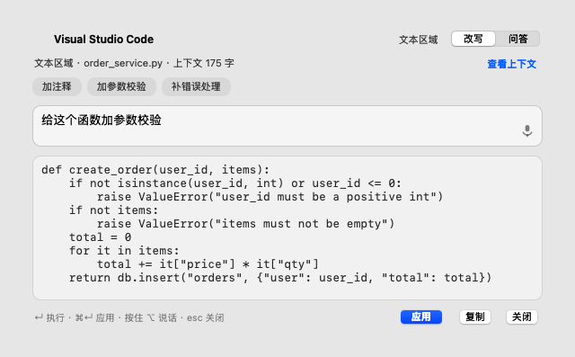
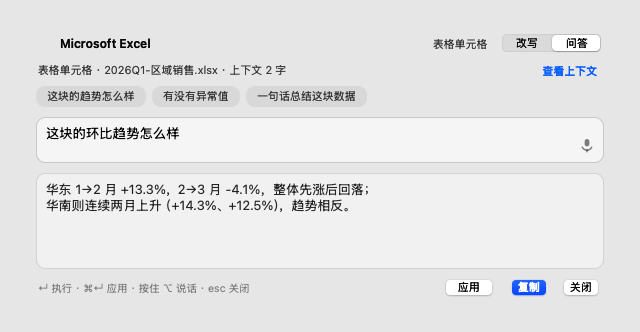
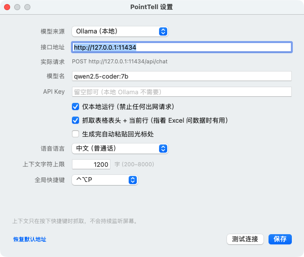
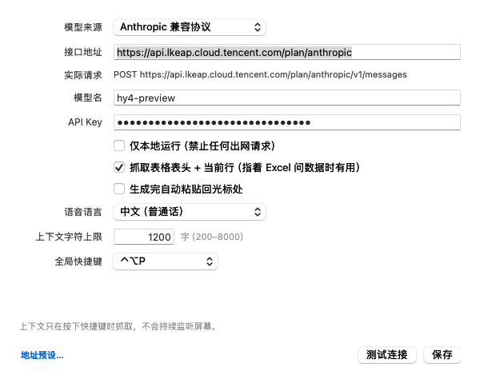

# PointTell · 指哪改哪

> 光标指到哪，AI 就改哪。macOS 版「指代式」操作层。

[English](README.md) · **简体中文**

不用复制、不用切窗口、不用解释"我在看什么"。把光标悬停在目标上，按一下快捷键，说一句话 —— AI 就地改掉或就地回答。





---

## 它解决什么

现在的 AI 工具都要求你先"解释上下文"：选中、复制、粘贴、再说"我在看这个函数"。Google DeepMind 的 AI Pointer 给出的解法是让光标本身携带上下文 —— 悬停即捕获，指着说"把这个改成两倍"。

PointTell 是这个思路的 macOS 轻量实现：**只做"指哪改哪 / 指哪问哪"这一件事，做深。**

## v0.1 能做什么

- **悬停即上下文**：`AXUIElementCopyElementAtPosition` 读取光标下的控件角色、文本、光标位置附近的内容（不是整篇文档）
- **指着表格问数据**：自动向上找到 `AXTable`，把表头 + 当前行 + 下一行一起带上，问"这块环比趋势怎么样"就能得到具体数字的回答
- **就地回写**：结果一键粘贴回原应用的光标处（VS Code / Xcode / Excel / 浏览器通用），覆盖当前选区
- **按住 ⌥ 说话**：设备端语音识别（`requiresOnDeviceRecognition`），说完直接执行
- **隐私优先**：默认只连本机 Ollama（`127.0.0.1:11434`），"仅本地"模式下任何出网请求都会被拦掉；API Key 存 Keychain；抓取只发生在按下快捷键的瞬间，不持续监听
- **上下文可审计**：点「查看上下文」能看到将要发给模型的原文

## 快速开始

```bash
git clone https://github.com/riemann-chow-product/point-tell.git
cd point-tell
./build.sh                 # 产物在 build/PointTell.app
open build/PointTell.app   # 菜单栏会出现一个箭头图标
```

首次启动会引导你开**辅助功能权限**（系统设置 › 隐私与安全性 › 辅助功能）。这个权限用来：读取光标下的控件文本、把结果粘贴回去。没有它应用无法工作。

> **如果设置里明明勾了，应用还显示"未授权"** —— 见下面「[辅助功能授权为什么勾了不生效](#辅助功能授权为什么勾了不生效)」，99% 是签名哈希变了导致的陈旧记录。

然后配模型（二选一）：

```bash
# A. 本地（推荐，隐私优先）
ollama pull qwen2.5-coder:7b     # 代码改写
# 或更小更快：ollama pull qwen2.5:3b
ollama serve                     # 默认 127.0.0.1:11434

# B. 任意 OpenAI 兼容 API
# 菜单栏图标 → 设置 → 模型来源改成「OpenAI 兼容 API」，填 baseURL / model / key
# 注意：需要同时关掉「仅本地运行」

# C. Anthropic 兼容（Claude 官方 / 腾讯云混元·GLM·Kimi）
# 模型来源改成「Anthropic 兼容协议」，地址填到 .../anthropic 这一层
# 腾讯云示例：https://api.lkeap.cloud.tencent.com/plan/anthropic
# 也可以点左下角「地址预设…」直接选，省得手打长域名
```

## 模型设置



Anthropic 兼容（腾讯云）配置的样子：



菜单栏图标 → 设置（也可以 `open build/PointTell.app --args --settings` 直接打开）。

| 项目 | 能改什么 |
| --- | --- |
| 模型来源 | 三选一：Ollama（本地）/ OpenAI 兼容 API / Anthropic 兼容协议。各自独立记住地址和模型，切来切去不会互相覆盖 |
| 接口地址 | 自由编辑。漏写 `http://` 会自动补（本机/局域网补 http，公网补 https），多写的结尾 `/` 或 `/api`、`/v1` 会自动归一 |
| 实际请求 | 只读，实时显示最终会打的完整 URL —— 不用猜地址拼出来是什么样 |
| 模型名 | 自由编辑，空值会被拦下 |
| API Key | 自由编辑，存 Keychain。本地 Ollama 可留空；云端必填 |
| 上下文字符上限 | 只能输数字（非数字直接被过滤），范围 200–8000 |
| 地址预设… | 左下角，现成的常用端点，点了连「模型来源」一起切好 |
| 其余 | 三个开关、语音语言、全局快捷键均为即时可选 |

### 三种协议别选错

| 模型来源 | 实际请求 | 什么时候用 |
| --- | --- | --- |
| Ollama（本地） | `POST {base}/api/chat` | 本机 `ollama serve` |
| OpenAI 兼容 API | `POST {base}/v1/chat/completions` | OpenAI、各类 one-api / 中转站、vLLM |
| Anthropic 兼容协议 | `POST {base}/v1/messages` | Claude 官方、腾讯云 Anthropic 兼容（混元 / GLM / Kimi） |

选错协议一定会 404，所以地址里出现 `/anthropic` 却选了 OpenAI 时，窗口会直接提示你改来源，不会白跑一次请求。

腾讯云那套最容易踩的坑是**域名拼写**：正确是 `api.lkeap.cloud.tencent.com`（L 开头），写成 `ikeap` 会 DNS 解析失败。用「地址预设…」可以直接选：

- 腾讯云 Anthropic 兼容 · TokenHub 计划版 → `https://api.lkeap.cloud.tencent.com/plan/anthropic`
- 腾讯云 Anthropic 兼容 · 知识引擎 → `https://api.lkeap.cloud.tencent.com/api/anthropic`

**「测试连接」分两步**，比直接发一次对话请求准得多：

1. 先探测服务：Ollama 打 `GET /api/tags`，OpenAI 打 `GET /v1/models`。秒回，能区分「服务没起」和「模型没装」，也能在花 token 之前就发现 API Key 无效。
2. 再真的让模型吐两个字（`max_tokens` 限 32），确认生成链路通，并显示耗时。

常见返回：

| 状态栏 | 含义 |
| --- | --- |
| `✓ 连接成功（1.2s）· 回复「正常」` | 通了 |
| `✗ 域名解析失败：xxx 不存在` | 域名拼错，或需要内网/VPN（`i/l`、`1/I` 最容易错） |
| `✗ 连不上 http://127.0.0.1:11434。Ollama 是否已启动？` | 服务没起，或端口/地址写错 |
| `✗ 模型「xxx」不可用。已安装：a、b` | 服务在，但模型没 pull，会顺手列出已装的 |
| `✗ API Key 无效或没填（HTTP 401）` | 云端 key 问题 |
| `✗ 接口路径不存在（HTTP 404）` | 协议选错，或地址没填到该停的层级 |
| `⚠️ 已开启「仅本地运行」…` | 隐私开关挡住了云端请求，取消勾选再测 |
| `⚠️ 服务与模型都在，但生成超时` | 本地模型首次加载慢（R1 这类推理模型尤其），不是配置错 |

两个刻意的设计：**测试连接不写盘**（改了框直接点测试，不会污染已保存的配置，只有点「保存」才生效）；**切换来源不会丢输入**（未保存的地址/模型/key 会按来源暂存）。

### 保存

点「保存」、按回车、按 `⌘S` 三者等价。保存成功会先显示「已保存」再关窗；被校验拦下会就地显示红字，不关窗。

**API Key 存哪**：优先钥匙串（service `com.pointtell.apikey`），同时镜像一份到 `~/Library/Application Support/PointTell/api-key.json`（权限 `0600`）。两处都失败时保存会显示黄字并**不关窗**，不会让你以为存上了。

为什么要镜像：钥匙串条目的 ACL 绑定在「创建它的那份签名」上。项目早期用 ad-hoc 签名，cdhash 每次编译都变；换成固定证书之后，旧条目就读不出来了（`SecItemCopyMatching` 返回 `-25293`），表现为「设置里明明存过 key，一用就 401」。镜像让签名变化不再丢 key。

旧 key 抢救：`./scripts/fix-api-key.sh`（读不到钥匙串时会用 `security` 命令行把值取出来写进上面那个文件），`./scripts/fix-api-key.sh --check` 只查看不写。

### 点了没反应怎么查

`/tmp/pointtell.log` 里有一行 `win.event down ... hit=... key=... active=...`，它把「点了没反应」的三种可能一次分开：

| 日志 | 含义 |
| --- | --- |
| 完全没有 `win.event down` | 事件没进窗口：应用未激活（第一下只用来激活），或窗口被别的窗口挡住 |
| 有 `win.event down` 但 `hit=` 不是按钮 | 点到了别的东西（布局错位） |
| 有 `win.event down` 且 `hit` 是按钮，但没有 `save: clicked` | 按钮的 target/action 没接上 |
| 有 `save: clicked` 但没有 `save: committed` | `commit()` 中途抛异常，看同文件里的 `UNCAUGHT EXCEPTION` 行 |

## 用法

| 操作 | 说明 |
| --- | --- |
| `⌃⌥P` | 在光标处唤起面板（快捷键可在设置里换） |
| 输入指令 + `↵` | 执行 |
| `⌘↵` | 把结果应用回原应用（任何模式下都可用）。应用后**面板不会立刻消失**，见下 |
| `⌘1` / `⌘2` | 切换「改写 / 问答」模式 |
| 按住 `⌥` 说话 | 语音输入，松开结束 |
| `esc` | 关闭 |

默认模式会按控件类型自动选：可编辑控件 → 改写；表格 / 静态文本 → 问答。

**「应用」按钮在任何模式下都在。** 问答模式下主按钮是「复制」（高亮），「应用」退到旁边 —— 指着编辑器说「翻译成英文」时也能直接写回去，不会因为模式判断而找不到按钮。模式判断本身也修了：控件类型只按 role 认会漏掉 Sublime / Electron / 网页编辑区（它们的 role 是 `AXGroup`），后台补全读到 `AXEditable` 后会自动纠正成改写模式。

**应用之后面板会留一会儿。** 点「应用」→ 内容立刻粘到目标应用 → 面板停在原地显示「✓ 已应用 · N 秒后收起」，N 按结果长度算（20 字/秒，最短 5 秒、最长 15 秒）。这期间点一下面板就留下不走，按 `esc` 立刻关。以前是点完立刻消失，结果改没改对都没机会看一眼。

试一下：

1. 用编辑器打开 `demo/sample.py`，光标停在 `create_order` 上，`⌃⌥P` → "给这个函数加参数校验" → `⌘↵`
2. 浏览器打开 `demo/table.html`，光标停在一个单元格上 → "这块的环比趋势怎么样"
3. 指着任意一段文字 → `⌘2` → "这段话有什么问题"

## 面板配色（看得清字）

面板是半透明毛玻璃，透出来的是背后界面的颜色。如果文字色只跟系统外观走，就会遇到最常见的翻车组合：**系统是浅色、编辑器是深色主题** —— 毛玻璃透出深底，文字却还是黑的。

所以每次唤起时做两件事：

1. **采样背后亮度**：截取光标下控件中间约 40×40 像素，降采样到 8×8 取中位数亮度（中位数能压掉文字、光标这类极端像素）。深色背景 → 面板整体切深色外观，浅色 → 切浅色。整张卡片一起换，不只是底色。
2. **底衬兜底**：即使判断不出来（没授权），也会在毛玻璃上垫一层朝当前外观靠的半透明底，保证任何背景下文字都有对比度。

| 设置里的「面板配色」 | 行为 |
| --- | --- |
| 自动（默认） | 按背后界面明暗切换，需要**屏幕录制**权限 |
| 深色 / 浅色 | 固定，不采样、不需要任何权限 |

没授权时「自动」会退回跟随系统外观（配合底衬仍然可读），设置窗口里会显示「授权屏幕录制」按钮。授权后需要退出并重开应用才生效。

预览图：`demo/preview-rewrite.png`（浅色）与 `demo/preview-rewrite-dark.png`（深色），`./scripts/render-preview.sh` 重新生成。

## 隐私设计

| 数据 | 去向 |
| --- | --- |
| 光标处的控件文本 | 只在按下快捷键时读取；只发给你配置的模型端点 |
| 剪贴板 | 应用结果时临时占用，0.6s 后还原 |
| API Key | Keychain（`com.pointtell.apikey`）+ `~/Library/Application Support/PointTell/api-key.json`（0600），不进 UserDefaults、不进日志 |
| 屏幕 | 不存档、不 OCR、不持续监听。「自动配色」开启时，只在唤起面板那一刻截取光标处约 40×40 像素算一次亮度，算完即弃，不落盘、不外发 |

「仅本地运行」默认开启：只要模型来源不是 Ollama，请求会被直接拦下并在面板里提示。

## 结构

```
Sources/
├── main.swift              入口（菜单栏 app，无 Dock）
├── AppDelegate.swift       生命周期 + 最小主菜单（否则 ⌘C/⌘V 失效）
├── OverlayController.swift 状态机：指 → 说 → 改
├── OverlayPanel.swift      悬浮卡片 UI（纯 AppKit 手写布局）
├── AXContext.swift         AX 读取：控件角色/文本/选区/表格片段
├── PromptBuilder.swift     system/user prompt + 场景化快捷指令
├── LLMClient.swift         流式客户端（Ollama NDJSON / OpenAI SSE）
├── SpeechRecognizer.swift  设备端语音识别
├── Paster.swift            剪贴板 + 合成 ⌘V 回写
├── HotkeyManager.swift     Carbon 全局热键（不需要输入监控权限）
├── HighlightWindow.swift   悬停目标的高亮框
├── ScreenSampler.swift     采样背后界面亮度 → 决定面板深/浅（配色自适应）
├── Settings.swift          配置（UserDefaults + Keychain）
├── SettingsWindow.swift    设置窗口
├── Onboarding.swift        权限引导
└── Support.swift           日志/角色名/快捷键显示等小工具
```

```
scripts/
├── package.sh              打包 dmg + zip + SHA256SUMS
├── release.sh              一条命令发版（版本号 → 构建 → tag → push）
├── render-preview.sh       把面板渲染成 demo/preview-*.png
├── fix-accessibility.sh    修辅助功能授权（清旧记录 + 打开面板）
└── fix-api-key.sh          从钥匙串抢救旧 API Key
```

一次调用的数据流：

```
⌃⌥P
 └→ ContextCapture.probe()               取光标下元素 + 角色（一次 IPC，0.35s 超时）
     ├→ ScreenSampler.isDarkBackdrop()   采一次背后亮度 → 面板切深/浅
     ├→ ContextCapture.enrich()          后台补正文 / 选区 / 表头当前行
     └→ PromptBuilder.messages()         按控件类型选 system prompt
         └→ LLMClient.start()            流式输出
             └→ Paster.insert()          剪贴板 + ⌘V 写回
```

## 打包与发版

### 为什么 arm64 只能交给 CI

本机是 **Intel（x86_64）**，且只装了 Command Line Tools —— 它自带的 Swift 标准库只有 x86_64 一份：

```
$ swiftc -target arm64-apple-macosx10.15 ...
error: unable to load standard library for target 'arm64-apple-macosx10.15'
```

所以本地构建只能产出 x86_64 的包（Apple Silicon 上靠 Rosetta 2 跑）。要出 **arm64 / 通用包**，只能在带完整 Xcode 的机器或 GitHub Actions 上构建 —— `.github/workflows/release.yml` 就是干这个的。

### 三个命令

```bash
./build.sh                       # 只编译：build/PointTell.app
./scripts/package.sh x86_64      # 只打包：dist/*.dmg / *.zip / SHA256SUMS.txt
./scripts/release.sh 0.2.0       # 发版：改版本号 → 构建 → 打包 → commit → tag → push
```

`make` 里有对应简写：`make app` / `make dist` / `make release VERSION=0.2.0`。

`release.sh` 的参数：

| 参数 | 作用 |
| --- | --- |
| `--no-push` | 只在本地产出并打 tag，不动远端（演练用） |
| `--publish` | 本地包用 `gh release create` 直接发（没装 gh 会给出安装提示） |
| `--archs "arm64 x86_64"` | 出通用包（需要完整 Xcode，本机不行） |

### 产物长什么样

```
dist/
├── PointTell-0.2.0-universal-macOS.dmg   # 拖拽安装，内含 /Applications 快捷方式
├── PointTell-0.2.0-universal-macOS.zip   # 解压即用，保留可执行位与签名
└── SHA256SUMS.txt
```

架构后缀是 `universal` / `arm64` / `x86_64`。`dist/` 每次打包都会清空，不会把旧版本的包混进 Release。

### 版本号只有一个来源

`Sources/AppInfo.swift` 里的 `static let version`。`build.sh` 用它注入 `Info.plist` 的 `CFBundleShortVersionString`，`CFBundleVersion` 用 `git rev-list --count HEAD` 自动生成。`release.sh` 只改这一个地方，不会再出现「关于窗口 0.1.4、dmg 名字 0.1.3」。

### 走 tag 触发 CI 发布

```bash
./scripts/release.sh 0.2.0     # 自动 commit + tag v0.2.0 + push
```

推上去之后 GitHub Actions（`macos-14`，Apple Silicon）会：

1. `POINTTELL_ARCHS="arm64 x86_64"` 编译两份，`lipo` 合并成通用二进制
2. `scripts/package.sh universal` 出 dmg + zip + 校验和
3. `softprops/action-gh-release` 建 Release 并上传 `dist/*`，自动生成变更说明

进度看 `https://github.com/riemann-chow-product/point-tell/actions`。

> 如果 `git push` 报 `Empty reply from server`，是代理没走对：
> `POINTTELL_GIT_PROXY=http://127.0.0.1:9090 ./scripts/release.sh 0.2.0`

### 签名与 Gatekeeper

| 场景 | 签名 | 用户装的时候 |
| --- | --- | --- |
| 本地 / CI 默认 | ad-hoc 或自签名证书 | 会被拦一次：右键 → 打开，或 `xattr -dr com.apple.quarantine /Applications/PointTell.app` |
| 有 Apple Developer 账号 | Developer ID + 公证 | 双击直接开 |

要接公证（$99/年 账号），在仓库 Secrets 里放证书和账号信息，然后：

```bash
POINTTELL_SIGN_ID="Developer ID Application: Your Name (TEAMID)" \
POINTTELL_KEYCHAIN=/path/to/temp.keychain \
POINTTELL_HARDENED=1 \
./build.sh
xcrun notarytool submit dist/PointTell-x.y.z-universal-macOS.zip \
  --apple-id "$APPLE_ID" --team-id "$TEAM_ID" --password "$APP_SPECIFIC_PASSWORD" --wait
xcrun stapler staple build/PointTell.app
```

没做公证之前，Release 页面的安装说明里要写清楚「右键打开」，否则用户会以为应用坏了。

## 辅助功能授权为什么勾了不生效

这是本机开发最常踩的坑，值得单独说清楚。

macOS 的辅助功能授权记录**绑定在代码签名的"指定需求"（designated requirement）上**。用 ad-hoc 签名（`codesign -s -`）时，这条需求是一条裸哈希：

```
designated => cdhash H"f8e8fd4374e762cdc9f23bcbe1fb908b79830acb"
```

问题在于：**每次重新编译，这个哈希都会变**。系统于是认为"这是一个新程序"，旧授权对不上。而系统设置里那条记录还留着、开关还显示开着 —— 所以看起来"我明明授权了"，实际一点用都没有。

`build.sh` 现在改用一张固定的自签名证书（`PointTell Dev`），需求变成：

```
designated => identifier "com.pointtell.app" and certificate leaf = H"c2a462b8..."
```

bundle id 和证书指纹都不随编译变化，所以**重建之后授权依然有效**。

证书放在 `~/Library/Keychains/pointtell-signing.keychain-db`（独立钥匙串，密码 `pointtell`，由 `build.sh` 自动解锁 —— 放在登录钥匙串里 `codesign` 会弹系统授权框卡住构建）。

**已经卡住过一次的话，需要手动清一次旧记录：**

```bash
./scripts/fix-accessibility.sh
```

它会打印当前签名、尝试 `tccutil reset`，然后打开辅助功能面板并在 Finder 里定位应用。剩下的手动两步：

1. 列表里选中 `PointTell`，点 `−` 移除（这一步是关键，不能只关开关）
2. 点 `+`，选 `build/PointTell.app`，再打开开关

之后重开应用，菜单栏应该显示「辅助功能权限：已授权」。

换机器或删了钥匙串导致证书丢失时，`build.sh` 会自动回退到 ad-hoc 并打印警告 —— 那时授权会重新退化成"每次重建都要勾一次"。

## 为什么它不会"卡住"

这类常驻工具最怕的不是报错，是**没反应**。几处刻意的设计：

| 场景 | 处理 |
| --- | --- |
| 目标应用无响应（Word 卡死、网页在加载） | AX 通信超时压到 `0.35s`；面板只等一次「取元素 + 角色」，其余上下文（正文、表格）后台补 |
| 用户很快按了回车，上下文还没读完 | 最多等 1 秒再生成，等不到就用现有上下文跑，绝不干等 |
| 网络切换 / 代理断开，连接半开 | 45 秒没收到任何字节就主动中断并说明原因（总超时 180s 只是兜底） |
| 推理模型先思考几十秒、正文还没出来 | 状态栏显示「🧠 模型思考中…（已 N 字）」，不是一动不动 |
| 模型把预算全花在思考上、正文为空 | 明确报「只输出了思考过程」，而不是给一个空白结果 |
| 点了「应用」但结果还没生成 | 先跑生成，出来自动应用（`pendingApply`），不再静默吞掉点击 |
| 应用完还没来得及看 | 面板停留 + 倒计时（按结果长度算），点一下可留下；不再「粘完就消失」 |
| 目标应用切不回前台 | **不发 ⌘V**（否则会粘到别的应用里），改为把结果留在剪贴板并提示 |
| 按住 ⌥ 时权限回调还没回来就松手 | 用「想不想录」的意图标志拦住，避免麦克风一直开着 |
| 语音说完却找不到「应用」按钮 | 「应用」常驻，模式只决定谁高亮；role 判断漏掉的可编辑控件会在后台补全后自动纠正成改写 |

## 已知限制

- 需要**辅助功能权限**；沙盒 / Mac App Store 上架路径未打通
- 少数应用（部分 Electron 版本、Java 应用）AX 树不完整，可能只拿到窗口标题 —— 面板会显示"未捕获控件"，此时仍可纯自然语言提问
- 结果回写走的是"剪贴板 + ⌘V"，会覆盖目标应用当前的选区（这正是改写想要的；问答模式下点「应用」同样会覆盖，只想取走文字就用「复制」）
- 构建是 `swiftc`（本机 Command Line Tools 只有 10.15 SDK）+ 自签名证书。证书可用时重建不影响授权；回退到 ad-hoc 时每次重建都要重新勾一次
- 语音识别依赖系统 `SFSpeechRecognizer`，设备端模型缺失时会退回在线识别
- 「面板配色 → 自动」需要**屏幕录制**权限（只用来读光标处一小块的平均亮度）；不给也能用，此时退回跟随系统外观，或手动固定深/浅

## Roadmap

- [ ] 选中区域截图 + 视觉模型（真正意义上的"指着图说话"）
- [ ] 多步指令（"把这个函数拆成两个"→ 预览 diff → 确认）
- [ ] 自定义 prompt 模板（每个 app 一套）
- [ ] 快捷键录制器
- [ ] 本地小模型内置（llama.cpp + 量化权重），彻底不依赖 Ollama

## 调试

```bash
tail -f /tmp/pointtell.log       # 运行日志
./scripts/render-preview.sh      # 离屏渲染面板示意（不需要录屏权限）
./scripts/settings-check.sh      # 设置窗口自检：输入框可编辑性 + 测试连接各分支
./scripts/fix-accessibility.sh   # 修辅助功能授权（清旧记录 + 打开面板）
./scripts/fix-api-key.sh         # 抢救读不出来的 API Key（旧签名遗留的钥匙串条目）
```

`scripts/render-preview.sh` 会把面板渲染成 `demo/preview-*.png`（含 `-dark` 深色配色版本），改完 UI 后跑一次就能看到效果。

`scripts/settings-check.sh` 会在 11500 端口起一个假的 Ollama/OpenAI（含 `/api/tags`、`/v1/models`），然后逐项验证：四个输入框能否真实键入、地址归一、测试连接的成功/404/拒连/401/隐私拦截五种结果，以及「测试不写盘」。改完设置窗口跑一次就知道有没有回归。
